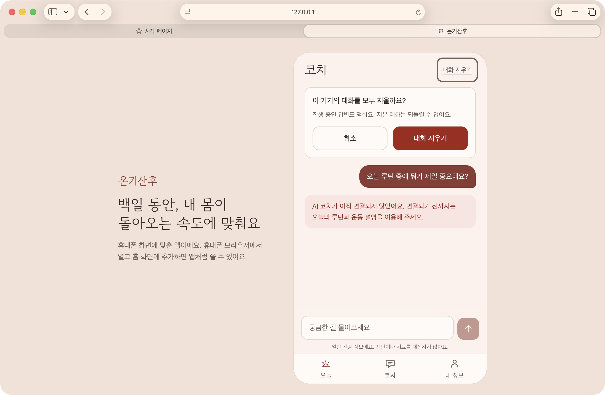
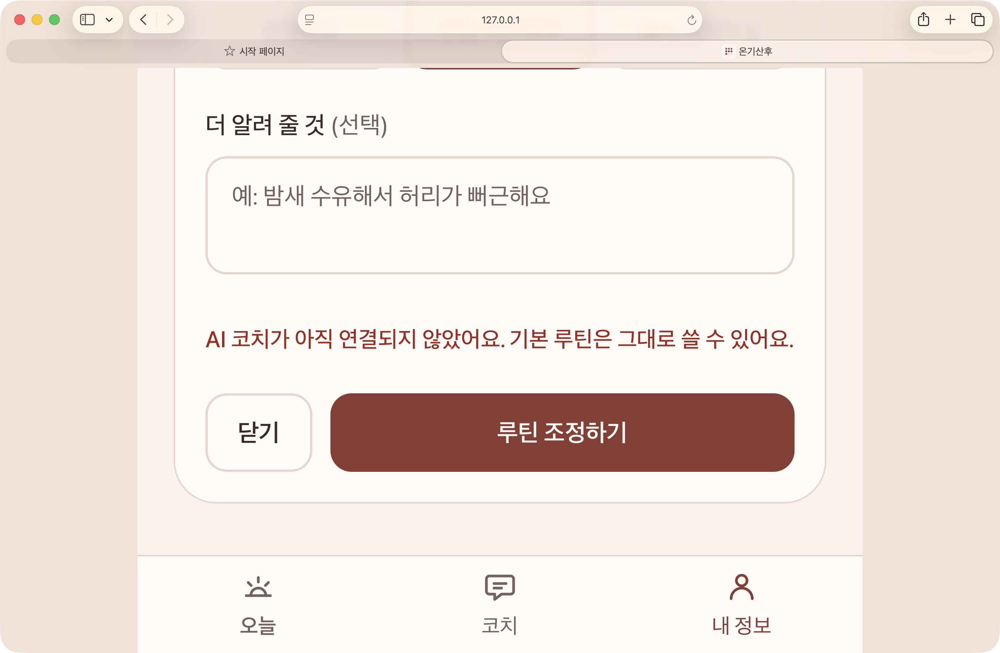

# 화면·사용 흐름 점검 기록

2026-11-23, 보안 수정과 함께 실제 브라우저에서 확인했다. 테스트 프로필은 임의의 데이터이며 AI 키를 비운 loopback 서버를 사용했다.

## 참고와 적용

- `design-reference-workflow`, `product-design:audit` 스킬을 적용했다.
- 로컬에 보관된 `awesome-design-md-main/design-md/claude/DESIGN.md`와 `wise/DESIGN.md`를 읽고, 읽기 순서·주요 행동의 위계·삭제 같은 중요한 행동의 구분을 참고했다. 원본 위치는 `/Users/handak/Downloads/awesome-design-md-main/`이다.
- 기존 [디자인 기준](DESIGN.md)의 색·글꼴·토큰을 유지했다. 새 라이브러리나 별도 색상 체계는 추가하지 않았다.
- [W3C 글자 확대 기준](https://www.w3.org/WAI/WCAG22/Understanding/resize-text.html)을 참고해 viewport의 확대 차단 설정을 제거했다.
- [W3C 상태 메시지 기준](https://www.w3.org/WAI/WCAG22/Understanding/status-messages.html)을 참고해 기존 오류 알림을 유지하고 요청 폼의 `aria-busy`, 취소 경로를 보강했다. 전체 WCAG 적합성 인증을 한 것은 아니다.

## 변경 사항

| 문제 | 반영 |
| --- | --- |
| 대화 삭제가 즉시 실행되고 처리 중 응답이 다시 저장될 수 있음 | 설명과 취소/삭제 버튼이 있는 확인 영역, 요청 중단, 저장 snapshot 비교 |
| AI에 전달되는 정보가 행동 시점에 잘 드러나지 않음 | 코치 첫 화면과 컨디션 조정 폼에 전송 정보 안내 |
| 처리 중 중복 요청·오래 멈춘 화면 | 요청 중복 차단, timeout, 조정 중 취소, 화면 이탈 시 중단 |
| 데이터 삭제 실패에도 성공처럼 이동 | 삭제 결과 확인과 오류 표시 |
| 글자 확대가 제한됨 | maximumScale/userScalable 제한 제거 |
| 긴 대화 뒤 최신 질문을 전송하지 못할 수 있음 | 최신 질문을 유지하며 요청 크기 안에서 이력 정리 |

## 실제 화면 순서와 결과

| 단계 | 확인 결과 | 증거 |
| --- | --- | --- |
| 1. 첫 화면 | 서비스 설명과 시작 버튼 확인 | [01](security-screens/01-home.png) |
| 2. 설문 | 필수 값 누락 안내, 출산일/분만 방식 등 5단계 완료 | [02](security-screens/02-onboarding.png) |
| 3. 오늘 | 백일 달력, 루틴, 주요 시작 버튼, 완료 수 확인 | [03](security-screens/03-today.png) |
| 4. 운동 상세 | 설명 확인 후 완료 체크, 오늘 화면에 1/6과 이어서 하기 반영 | [04](security-screens/04-exercise.png) |
| 5. 코치 | 빈 화면 안내와 추천 질문, 키 없는 오류 안내 확인 | [05](security-screens/05-coach.png) |
| 6. 대화 삭제 확인 | 취소/삭제 분리와 되돌릴 수 없음 안내 확인, 취소 후 대화 유지 | [06](security-screens/06-delete-confirm.png) |
| 7. 내 정보 | 프로필과 개인정보 설명 확인 | [07](security-screens/07-profile.png) |
| 8. 확대 | 브라우저 확대 5단계에서 읽기와 줄바꿈 확인, 정확한 확대율은 계측하지 않음 | [08](security-screens/08-zoom.png) |
| 9. 루틴 조정 실패 | AI 미연결 메시지와 기본 루틴 유지 확인, 닫기로 복귀 | [09](security-screens/09-adjust-error.png) |

Safari의 실제 화면과 접근성 트리를 함께 확인했다. 첫 Chrome 제어가 중간에 응답하지 않아 Safari로 이어서 검증했다. 삭제의 최종 실행은 브라우저에서 하지 않았고, 성공/실패 및 늦은 응답의 재저장 방지는 저장소 회귀 테스트로 검증했다. 기존 사용자의 저장 데이터는 삭제하지 않았다.

### 변경된 삭제 확인

### 확대 상태의 오류 복구

## 추가 검증 범위

실제 iPhone/Android의 터치·키보드·접근성 글꼴 설정, 화면 낭독기, 전체 대비 수치 검사는 아직 하지 않았다. 이번 확대 검증은 데스크톱 브라우저 조작 결과이며 실제 모바일 기기 검증으로 대체하지 않는다. 기존 시뮬레이터 검증 기록은 [DESIGN.md](DESIGN.md)에 별도로 남아 있다.
